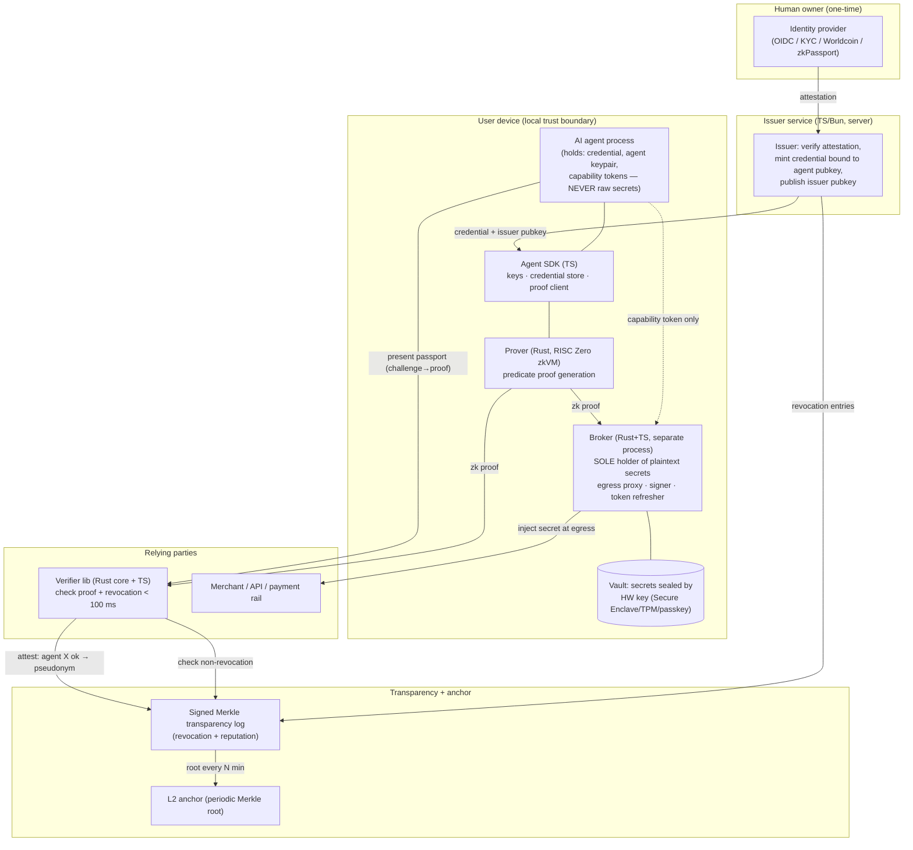

# 01 — PRD & Architecture Spec

- Status: **APPROVED** (2026-05-29)
- Date: 2026-05-29
- Traces to: [`00-requirements.md`](./00-requirements.md) · Linear:
  [`agent-zk-passport`](https://linear.app/claw-village/project/agent-zk-passport-f28af2c581a7)

## 1. Goal

Give a personal AI agent a **portable identity passport** and a **hardware-backed secret
vault** that work as one system: the agent proves — in zero knowledge — that it is owned by
an attested human, is not revoked, and meets per-request policy predicates; that proof
authorizes a local broker to **use** the user's secrets (API keys, wallet keys, OAuth
tokens) on the agent's behalf and return only results. **The dominant constraint: a raw
secret must never be exfiltrable to the agent, a log, a proof witness, or the network —
ever.** Everything else is subordinate to that invariant.

## 2. Non-goals

- Not building payment rails (integrate Stripe / x402 / on-chain, don't replace).
- No native browser anonymous-credential integration in v1 (SDK + reference verifier only).
- No agent→agent delegation chains in v1 (single-hop owner→agent).
- No cloud/remote custody in v1 (local hardware-backed only; remote TEE deferred).
- No full W3C VC compliance in v1 (compact purpose-built format, VC-mappable later).

## 3. Architecture

Four trust domains. The **broker is the only component that ever sees a plaintext secret**,
and it lives in its own process/address space — never inside the agent.



**The capability flow (resolves the zkVM-latency problem):**

1. Periodically (or on policy change), the agent asks the SDK→prover to generate a passport
   proof for a predicate set (e.g. `owner≥18 ∧ not_revoked ∧ daily_spend≤$200`).
2. The agent presents that proof **to the local broker**. The broker verifies it, checks
   the revocation root, and **mints short-lived capability tokens** (Biscuit) scoped to
   specific operations (`sign:eth:<addr>`, `http:POST:api.stripe.com/v1/charges`, …).
3. For each actual secret use, the agent presents a capability token to the broker. The
   broker performs the op with the sealed secret and returns the *result*. **No proof is
   run per op; no secret crosses the boundary.**
4. A relying party (merchant/verifier) independently challenges the agent and verifies the
   same kind of passport proof to decide whether to accept its traffic / payment.

This split is the core design decision — see §7.

## 4. Components

Monorepo. TypeScript packages on Bun; Rust crates in a Cargo workspace. Many small packages.

| Package / crate | Lang | Responsibility | Sees plaintext secret? |
|---|---|---|---|
| `packages/credential` | TS | Credential schema, encode/decode, issuer-pubkey verify, Zod schemas (shared types) | no |
| `packages/agent-sdk` | TS | Agent keypair gen, credential store, proof orchestration, capability client | no |
| `packages/verifier` | TS | Thin TS API over the Rust verifier core; challenge/response; revocation check | no |
| `packages/issuer` | TS (Hono) | Onboard human via IdP, mint credential bound to agent pubkey, publish keys, push revocations | no (handles attestations, not user secrets) |
| `packages/broker` | TS + Rust FFI | **The trust core.** Sealed-vault access, egress proxy, signer, OAuth refresh, capability minting/verification | **YES — only here** |
| `packages/transparency-log` | TS | Append-only signed Merkle log; status-list + reputation entries; L2 anchor job | no |
| `packages/demo-merchant` | TS (Hono) | Sample site that rejects un-passported traffic; E2E target | no |
| `crates/zk-predicates` | Rust | RISC Zero **guest** programs: predicate circuits over committed credential attributes | no (operates on commitments/witness, never raw API secrets) |
| `crates/prover` | Rust | RISC Zero **host**: run guest, produce receipts; local + optional remote (Bonsai) prover | no |
| `crates/verifier-core` | Rust | Verify RISC Zero receipts + journal; exposed to TS via napi/FFI | no |
| `crates/vault` | Rust | HW-sealed secret storage: wrap/unwrap data key via OS keystore (Secure Enclave/TPM), envelope-encrypt secrets | **YES — only here** |

**Deliberately NOT abstracted in v1:** no pluggable "KMS provider" interface (one local
HW-backed vault impl); no multi-chain anchor abstraction (one L2); no generic
"proof-system adapter" (RISC Zero only). Add seams when a second implementation actually
exists — not before.

## 5. Data model

**Credential (issued, held by agent, never leaves device in the clear):**
- `version`, `issuer_id`, `schema_id`
- `agent_pubkey` — binds the credential to this agent's key (prevents transfer/theft reuse)
- `attribute_commitments` — Pedersen/Merkle commitments to attributes (age, jurisdiction,
  KYC tier, spend limits). Raw attributes are **never** stored in the credential.
- `revocation_id` — opaque handle the issuer can add to the revocation status list
- `issued_at`, `expires_at`
- `issuer_signature` over the above

**Vault record (sealed, broker-only):**
- `secret_id`, `type` (`api_key` | `oauth` | `eth_key` | `generic`)
- `ciphertext` — secret envelope-encrypted under a per-record data key
- `wrapped_data_key` — data key wrapped by the HW-sealed master key (never extractable)
- `policy` — allowed operations, scopes, rate/spend limits, required predicates
- `metadata` (label, created_at) — **no secret material**

**Capability token (Biscuit, short-lived, held by agent):**
- caveats: `secret_id`, `operation`, `scope`, `expires_at`, `max_uses`, `bound_proof_hash`
- attenuable (agent can narrow, never widen)

**Transparency-log entry:** `seq`, `type` (`revoke` | `attest`), `revocation_id` or
`pseudonym`, `payload_hash`, `issuer/verifier_sig`. Root anchored to L2 every N minutes.

**Invariants:** (a) no table/column outside `crates/vault` + broker ever stores plaintext
secret material; (b) the credential stores commitments, not attributes; (c) a capability is
only valid while its `bound_proof_hash` references a still-unrevoked passport.

## 6. Interfaces / API

All boundary inputs validated with Zod (TS) / typed deserialization (Rust). Shapes
(signatures, not full bodies):

**Agent SDK (TS):**
```ts
createAgentIdentity(): Promise<{ agentPubkey: string }>
storeCredential(cred: Credential): Promise<void>        // Credential = Zod schema in packages/credential
provePredicates(req: PredicateRequest): Promise<PassportProof>   // calls Rust prover
presentTo(verifierChallenge: Challenge): Promise<PassportProof>
```

**Broker (local IPC — Unix domain socket, never a network port):**
```ts
mintCapabilities(proof: PassportProof, ops: OpRequest[]): Promise<Capability[]>
exec(cap: Capability, op: OpInput): Promise<OpResult>   // sign | http-proxy | oauth-refresh
// NOTE: there is NO `getSecret` / `exportSecret` endpoint. By construction.
```

**Verifier (TS over Rust core):**
```ts
challenge(): Challenge
verify(proof: PassportProof, challenge: Challenge): Promise<VerifyResult>  // < 100 ms, offline
```

**Issuer (HTTP, Hono):** `POST /onboard` (IdP attestation → session), `POST /mint`
(attested session + agent pubkey → credential), `GET /.well-known/issuer-keys`.

Canonical schemas live in `packages/credential` and are imported by every package so docs
and validation can't drift.

## 7. Key decisions & algorithms

1. **Proof gates capabilities, capabilities gate operations (the central decision).**
   RISC Zero proving is too slow to run on every secret use. So a passport proof is run
   *periodically* and exchanged for **short-lived Biscuit capability tokens**; each
   individual secret operation only needs a capability check (sub-ms), not a fresh proof.
   This satisfies "proofs gate every secret use" (no capability exists without a valid
   proof behind it) while staying interactive. Capability TTL is the security/latency dial.

2. **The broker is the only secret-bearing component, in a separate process.** The agent —
   the part most exposed to prompt injection and untrusted tool output — is structurally
   incapable of reading a secret: there is no export API, and the IPC surface only returns
   operation *results*. Egress secrets (API keys) are injected by the broker acting as a
   forward proxy, so they appear on the wire to the third party but never in agent memory.

3. **Hardware-sealed envelope encryption.** A master key is generated in and never leaves
   the OS hardware boundary (Secure Enclave / TPM / passkey). Per-secret data keys are
   wrapped by it; user-presence (passkey/biometric) can gate unwrap for high-value ops.

4. **Credential stores commitments, proofs disclose predicates.** Attributes never live in
   the credential or cross a proof boundary; the zkVM guest proves `f(attributes) = true`
   against commitments, emitting only the boolean + a non-revocation check in its journal.

5. **Offline verification + transparency-log revocation.** Verifier needs only the issuer
   public key and the latest signed revocation root (cached, periodically anchored to L2) —
   no issuer round-trip, meeting the < 100 ms budget.

## 8. Observability

- **Structured logs (pino, TS) with a hard secret-redaction layer** in the broker; a unit
  test asserts no `secret_id` payload, key bytes, or token ever reach a log sink.
- Metrics: proof gen time, capability mint rate, verify latency (p50/p99 vs 100 ms budget),
  revocation-root staleness, broker op error rate.
- Audit trail: every broker `exec` logs `(capability id, operation, scope, result status)`
  — never inputs/outputs that contain secret material.
- Alert on: verify p99 > 100 ms, revocation root stale > anchor interval, any broker
  deserialize/auth failure spike, any redaction-layer assertion failure in prod.

## 9. Security

**Trust boundaries:** human↔issuer · agent↔broker (the critical one) · agent↔verifier ·
verifier↔transparency-log. The agent is treated as **potentially compromised by prompt
injection at all times** — the design must hold even then.

**Threat model (must be covered by the security review):**
| Threat | Mitigation |
|---|---|
| Secret exfiltration via agent / prompt injection | No export API; broker-only plaintext; results-only IPC; egress proxy injection |
| Credential theft / replay on another agent | `agent_pubkey` binding; proofs signed by agent key; challenge nonces |
| Linkability across verifiers | Predicate-only disclosure; per-context pseudonyms; no raw attributes |
| Issuer compromise | Published issuer keys + key rotation; revocation; minimal attributes minted |
| Broker compromise | Smallest possible TCB; HW-sealed keys (not extractable even with broker RCE); user-presence gating on high-value ops |
| Capability misuse | Short TTL, max-uses, scope caveats, `bound_proof_hash` tied to non-revocation |
| Stale revocation | Anchored root + staleness alert; verifier rejects roots older than threshold |
| Secret in logs / proof witness | Redaction layer + tests; commitments-not-attributes in circuits |

**Hard rules (also in `context.md`):** raw secrets never cross the broker boundary; never
logged; never placed in a proof witness; `.env`/keys never committed.

## 10. Assumptions & tradeoffs

- **Assume** the user's device OS keystore (Secure Enclave/TPM/passkey) is trustworthy;
  if the device is fully rooted, local custody cannot fully protect — remote TEE is the
  future answer (deferred).
- **Traded** per-operation proof freshness for interactivity (capability TTL window) — a
  revoked passport is only fully enforced at the next mint / TTL expiry, bounded by TTL.
- **Traded** W3C VC interop now for a compact format we control; mapping is a later cost.
- **Traded** full decentralization for latency — transparency log has a trusted operator
  between L2 anchors.
- **Chose** RISC Zero (write predicates in plain Rust, no per-circuit trusted-setup
  ceremony, STARK→SNARK wrapping for compact on-chain-verifiable receipts) over
  Groth16/Circom (smaller/faster proofs but rigid circuits + ceremony) — flexibility of the
  predicate language matters more here than raw proof size, and capabilities absorb the
  latency cost.

## 11. Open questions

- Key rotation / agent fork: re-issue bound to new agent key + revoke old — needs a slice.
- Which L2 to anchor on (candidate: Base Sepolia for v1 testnet).
- Which identity provider to wire first (candidate: an OIDC provider; Worldcoin/zkPassport
  as a sovereign-ID track).
- RISC Zero local prover latency on agent-grade hardware vs. falling back to a remote prover
  (Bonsai) — measure before fixing capability TTL defaults.
- Biscuit vs. macaroons for capability tokens (leaning Biscuit — Rust-native, offline
  attenuation/verification).
